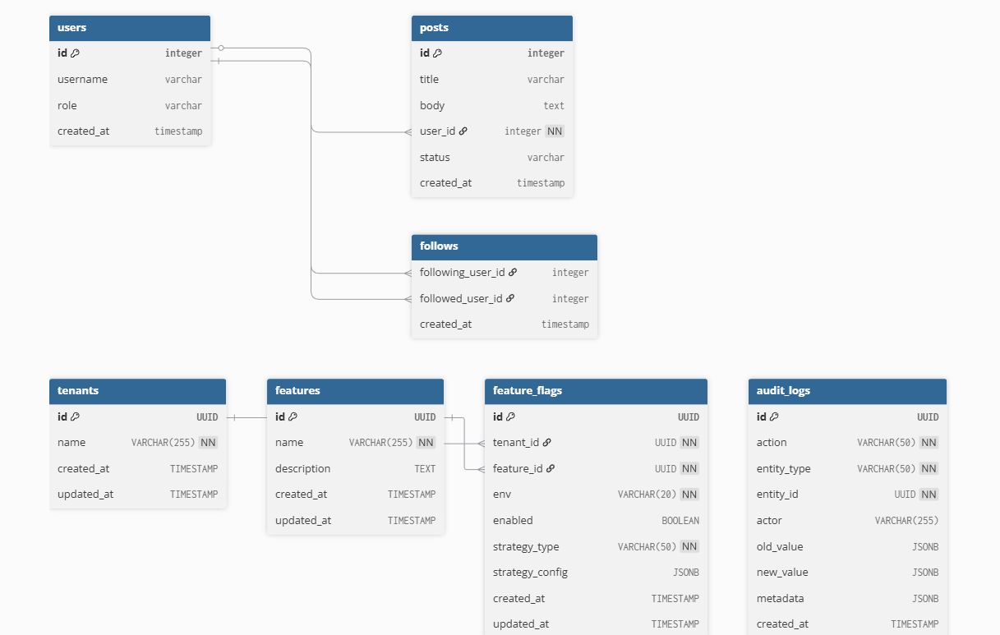

## Zebra Electronics Feature Toggle Service

Multi-tenant Feature Toggle Service – **Node.js + TypeScript + PostgreSQL + Redis + React Admin UI**

Bu servis, birden fazla tenant’ın (müşteri / ürün hattı) **env (dev / staging / prod)** bazında feature flag yönetmesini sağlar.  
Amaç, Zebra Engineering Assignment’ta istenen şekilde **ölçeklenebilir, güvenli, test edilebilir ve gözlemlenebilir** bir toggle platformu sunmaktır.

---

### Genel Mimari Özeti

- **Backend**: Node.js + TypeScript + Express  
  - Çok‑tenant veri modeli (`tenants`, `features`, `feature_flags`, `audit_logs`)  
  - JWT ve API Key tabanlı authentication  
  - Tenant bazlı authorization ve Redis‑backed rate limiting  
  - Redis cache (feature flag read’leri için) + ETag / invalidation mantığı  
  - Feature evaluation stratejileri: `boolean`, `percentage`, `user_targeting`  
  - Audit log, environment promotion, Prometheus metrics

- **Admin UI**: React + Vite + TypeScript (`admin-ui/`)  
  - Tenant için login → feature listesi → env filtreleme  
  - Feature flag create / edit / delete formları  
  - Audit log listesi  
  - Env promotion (ör. staging → prod) için ekran

- **Veritabanı**: PostgreSQL (Knex migrations ile yönetilir)

- **Cache & Rate Limit**: Redis

- **Monitoring**:  
  - Backend’te `/metrics` endpoint’i (Prometheus formatı)  
  - Docker Compose içinde Prometheus + Grafana stack’i

- **Packaging**:  
  - Production için çok aşamalı Dockerfile  
  - `docker-compose.yml` ile Postgres + Redis + App + Prometheus + Grafana

---

## 🚀 Çalıştırma Rehberi

### Gereksinimler

- Node.js >= 18
- npm >= 9
- Docker + Docker Compose

### 1. Local (Docker kullanmadan) Backend

1. Bağımlılıkları yükleyin:

```bash
npm install
```

2. Environment değişkenlerini ayarlayın:

```bash
cp .env.example .env
# .env içindeki DB/Redis/JWT ayarlarını düzenleyin
```

3. PostgreSQL ve Redis’i lokalinizde çalıştırın (veya docker-compose.dev.yml kullanın).

4. Migration ve seed:

```bash
npm run migrate:latest
npm run seed:dev
```

5. Geliştirme modunda backend:

```bash
npm run dev
# API: http://localhost:3000
```

6. Admin UI:

```bash
cd admin-ui
npm install
npm run dev
# UI: http://localhost:5173
```

### 2. Production / Docker Compose

Tüm stack’i (app + Postgres + Redis + Prometheus + Grafana) docker ile ayağa kaldırmak için:

```bash
docker compose up -d
```

Servisler:
- Backend API: `http://localhost:3000`
- Swagger UI: `http://localhost:3000/docs`
- Admin UI (local çalıştırırsanız): `http://localhost:5173`
- Prometheus: `http://localhost:9090`
- Grafana: `http://localhost:3001` (varsayılan kullanıcı: `admin` / `admin`)

Detaylı senaryolar için `QUICK_START.md` ve `DEPLOYMENT.md` dosyalarına bakabilirsiniz.

---

## 📁 Klasör Yapısı ve Katmanlar

```text
src/
├── app.ts            # Express app, middleware zinciri, route binding
├── config/           # DB, Redis, logger, swagger, app config
├── middleware/       # auth, authorization, rate limit, cache, validator, error handler, metrics
├── models/           # Knex modelleri (FeatureFlag, Feature, Tenant, AuditLog, vb.)
├── services/         # İş mantığı (FeatureFlagService, PromotionService, AuthService, CacheService...)
├── routes/           # REST API rotaları (features, auth, audit-logs, promote, metrics, swagger...)
├── utils/            # Yardımcılar (metrics, response, errors, hashing, vs.)
├── types/            # Ortak TypeScript tipleri (auth, strategy, pagination, env, vb.)
└── controllers/      # (Gerekli olduğu yerde ince controller katmanı)
```

### Katmanlar Arası Akış

Örnek: **GET /api/v1/features?tenant=...&env=prod**

1. **İstek UI / client’tan gelir** → Express `app.ts` içinde `/api/v1/features` route’una düşer.
2. **Middleware zinciri**:
   - `authenticationMiddleware.authenticate` → JWT veya API Key doğrulanır, `req.user` / `req.apiKey` set edilir.
   - `requireAuth` → kimlik doğrulaması zorunlu.
   - `requireTenantFromRequest` → token’daki tenant ile query’deki `tenant` eşleşir; multi‑tenant izolasyon sağlanır.
   - `rateLimitMiddleware` → Redis’te tenant/api-key bazlı sayaçlar ile burst + sustained limitler uygulanır.
   - `validate(getFeaturesSchemaWithUser)` → Zod ile query parametreleri doğrulanır.
3. **Route handler**:
   - Query `FeatureFlagService.getFeatureFlags` metoduna aktarılır.
4. **Service katmanı**:
   - Redis cache’te `(tenant, env, page, limit)` için daha önce üretilmiş sonuç var mı kontrol edilir.
   - Yoksa Postgres’ten `FeatureFlagModel.findAll/count` ile veri çekilir.
   - İlgili evaluation stratejileri (`StrategyEvaluator`) ile flag’ler kullanıcı bağlamında (`userId`) değerlendirilir.
   - Sonuç cache’e yazılır ve Prometheus metrics sayaçları (fetch, cache hit/miss, DB query süresi vs.) güncellenir.
5. **Response**:
   - `sendSuccess` helper’ı ile standart `{ success: true, data: { data, pagination } }` formatında JSON döndürülür.

Benzer şekilde:
- **POST /features** → FeatureFlagService `createOrUpdateFeatureFlag`  
  - Transaction açar, feature_flag kaydını upsert eder, audit log kaydı oluşturur, cache invalidation tetikler.
- **DELETE /features/:id** → Audit log + cache invalidation ile soft/birebir delete işlemi.
- **POST /promote** → PromotionService ile environment promotion; conflict resolution (skip / overwrite / merge) ve dry-run desteği.

---

## 🧱 Veri Modeli (Özet)

- `tenants`  
  - `id`, `name`

- `features`  
  - `id`, `name` (ör. `new-dashboard`, `beta-search`), `description`

- `feature_flags`  
  - `id`, `tenant_id`, `feature_id`, `env` (`dev|staging|prod`), `enabled`,  
  - `strategy_type` (`boolean|percentage|user_targeting`),  
  - `strategy_config` (JSON), `created_at`, `updated_at`

- `audit_logs`  
  - `id`, `action` (`CREATE|UPDATE|DELETE`), `entity_type`, `entity_id`, `actor`,  
  - `old_value`, `new_value`, `metadata`, `created_at`

İlgili tablolara ilişkin migration’lar `migrations/` klasöründedir ve **Knex + TypeScript** ile yönetilir.

---

### 📦 Database Şeması (DDL Özeti)

Aşağıdaki şema, migration dosyalarında tanımlanan yapının sadeleştirilmiş halidir:

```sql
CREATE TABLE tenants (
  id          UUID PRIMARY KEY,
  name        VARCHAR(255) NOT NULL UNIQUE,
  created_at  TIMESTAMP DEFAULT NOW(),
  updated_at  TIMESTAMP DEFAULT NOW()
);

CREATE TABLE features (
  id          UUID PRIMARY KEY,
  name        VARCHAR(255) NOT NULL UNIQUE,
  description TEXT,
  created_at  TIMESTAMP DEFAULT NOW(),
  updated_at  TIMESTAMP DEFAULT NOW()
);

CREATE TABLE feature_flags (
  id             UUID PRIMARY KEY,
  tenant_id      UUID NOT NULL REFERENCES tenants(id) ON DELETE CASCADE,
  feature_id     UUID NOT NULL REFERENCES features(id) ON DELETE CASCADE,
  env            VARCHAR(16) NOT NULL CHECK (env IN ('dev','staging','prod')),
  enabled        BOOLEAN NOT NULL DEFAULT FALSE,
  strategy_type  VARCHAR(32) NOT NULL,
  strategy_config JSONB,
  created_at     TIMESTAMP DEFAULT NOW(),
  updated_at     TIMESTAMP DEFAULT NOW(),
  UNIQUE (tenant_id, feature_id, env)
);

CREATE TABLE audit_logs (
  id          UUID PRIMARY KEY,
  action      VARCHAR(16) NOT NULL, -- CREATE / UPDATE / DELETE
  entity_type VARCHAR(64) NOT NULL,
  entity_id   UUID NOT NULL,
  actor       VARCHAR(255),
  old_value   JSONB,
  new_value   JSONB,
  metadata    JSONB,
  created_at  TIMESTAMP DEFAULT NOW()
);

-- Assignment önerisine uygun composite index
CREATE INDEX idx_feature_flags_tenant_env
  ON feature_flags (tenant_id, env);
```

Detaylı ve güncel şema için doğrudan `migrations/` klasöründeki TypeScript migration dosyalarına bakabilirsiniz.

---

### 🗺️ ER Diagram

Assignment’te tanımlanan tablo ilişkilerini gösteren görsel ER diyagramı:



Bu diyagram, **tenants → feature_flags → features** ilişkisini ve değişikliklerin `audit_logs` tablosunda nasıl izlendiğini MySQL Workbench tarzı görünümle özetler.

---

## ⚙️ Ölçeklenebilirlik ve Güvenlik

- **Stateless backend**:  
  - Tüm state Postgres (kalıcı veri) ve Redis’te (cache, rate limit, token blacklist) tutulur; bu sayede backend instance sayısı yatayda artırılabilir.

- **Multi‑tenant izolasyon**:  
  - Tüm feature flag sorgularında `tenant_id` zorunlu; authorization middleware’i token’daki tenant ile istekten gelen tenant’ı eşler.

- **Rate limiting**:  
  - Redis tabanlı per‑tenant / per‑API key sayaçları; hem burst hem sustained pencere için limitler.  
  - `X-RateLimit-*` header’ları üzerinden istemciye remaining quota bilgisi verilir.

- **Caching**:
  - Feature flag listeleri için Redis cache anahtarları `(tenant, env, page, limit)` kombinasyonu ile tutulur.
  - Flag create/update/delete sonrası ilgili anahtarlar invalid edilir.
  - Bu sayede okuma trafiğinde düşük latency ve yüksek throughput sağlanır.

- **Error handling**:
  - Özel `AppError` sınıfları (`ValidationError`, `UnauthorizedError`, `ForbiddenError`, `NotFoundError`, vs.)  
  - Global `errorHandler` middleware’i ile tutarlı `{ success: false, error: { code, message, details } }` formatında cevaplar.

---

## 🧪 Test Edilebilirlik

Proje, baştan itibaren **test edilebilir mimari** ile tasarlanmıştır:

- Servisler, modeller, cache ve dış bağımlılıkları constructor üzerinden alan **dependency injection** yaklaşımı kullanır.
- Unit ve integration testleri Jest ile yazılmıştır.

```bash
# Tüm testler
npm test

# Watch modu
npm run test:watch

# Coverage
npm run test:coverage
```

Testlerde:
- Auth, rate limit, cache, strategy evaluation, audit log, promotion akışı gibi kritik parçalar kapsanır.

---

## 🧭 Migration Workflow

Migration komutları:

```bash
# Yeni migration oluştur
npm run migrate:make migration_name

# Migration'ları uygula
npm run migrate:latest

# Migration'ı geri al
npm run migrate:rollback
```

**Production yaklaşımı:**
- Migration’lar CI/CD pipeline’ında `npm run migrate:latest` ile apply edilir.
- Tüm migration’lar idempotent ve geri alınabilir olacak şekilde yazılır (Knex `down` fonksiyonları).
- Şema değişiklikleri için `DEPLOYMENT.md` dosyasında rollout / rollback stratejisi özetlenmiştir.

---

## 📚 API Dokümantasyonu

Swagger/OpenAPI ile otomatik üretilen dokümantasyona erişim:

- Swagger UI: `http://localhost:3000/docs`
- Swagger JSON: `http://localhost:3000/docs/json`

Ana endpointler:
- `/api/v1/features`
- `/api/v1/auth/*`
- `/api/v1/audit-logs*`
- `/api/v1/promote`
- `/metrics`, `/metrics/json`

---

## 📊 Monitoring ve Observability

- **Health Check**  
  - `GET /health` → uygulamanın hazır / sağlıklı olup olmadığını bildirir.

- **Metrics (Prometheus)**  
  - `GET /metrics` → Prometheus formatında metrikler  
  - `GET /metrics/json` → JSON formatında metrikler  
  - Örnek metrikler: flag fetch sayıları, cache hit/miss, DB query süreleri, rate limit istatistikleri.

- **Docker içi monitoring stack**  
  - `prometheus` servisi, `app:3000/metrics` endpoint’inden metrikleri okur.  
  - `grafana` servisi, Prometheus’u veri kaynağı olarak kullanır; buradan dashboard ve alarm tanımlanabilir.

---

## 💻 Admin UI (React + Vite + TS)

`admin-ui/` klasöründe, backend API’leri ile birebir uyumlu bir admin panel bulunur:

- Login sayfası → JWT token alır, `localStorage`’a yazar.
- Feature Flags sayfası:
  - Env filtresi (`dev/staging/prod`),
  - Listeleme (cache + pagination backend tarafından yönetilir),
  - Create / edit modal formu (strategy seçimi ve config girişi),
  - Delete butonu.
- Audit Logs sayfası → `/api/v1/audit-logs` üzerinden filtreli liste.
- Promotion sayfası → `/api/v1/promote` endpoint’i ile dry-run veya gerçek promotion.
